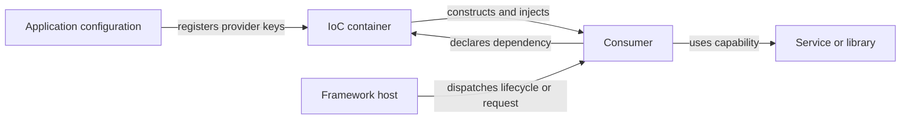

# Inversion of Control

The user object declares what it needs; a container resolves dependencies and the host drives application lifecycle. Constructor injection is a common DI form. Framework-managed callbacks extend the same broad inversion of control beyond object construction. This simplified graph is conceptual, not a runtime trace. [1] [3]

